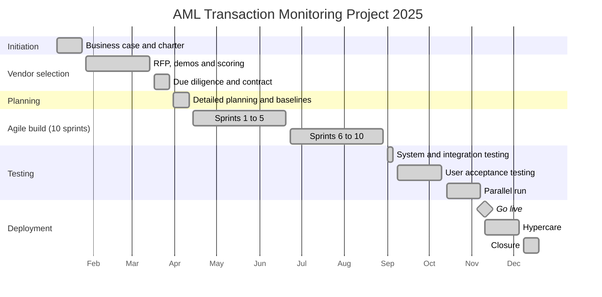

# Project Schedule
## AML Transaction Monitoring System Implementation

Baselined April 11, 2025. Total duration: about 11.5 months (January 6 to December 19, 2025).

## Timeline

## Milestones

| # | Milestone | Baseline date | Actual date | Status |
|---|---|---|---|---|
| M1 | Charter approved | Jan 24, 2025 | Jan 24, 2025 | Met |
| M2 | Vendor contract signed | Mar 28, 2025 | Mar 28, 2025 | Met |
| M3 | Plan baselined | Apr 11, 2025 | Apr 11, 2025 | Met |
| M4 | Configuration and integration complete | Aug 29, 2025 | Aug 29, 2025 | Met |
| M5 | UAT sign off | Oct 10, 2025 | Oct 10, 2025 | Met |
| M6 | Parallel run complete | Nov 7, 2025 | Nov 7, 2025 | Met |
| M7 | **Go live** | **Nov 10, 2025** | **Nov 10, 2025** | **Met** |
| M8 | Project closed | Dec 19, 2025 | Dec 19, 2025 | Met |

## Sprint calendar

| Sprint | Dates | Sprint goal |
|---|---|---|
| 1 | Apr 14 to Apr 25 | Secure connection and first transaction extract loaded in test |
| 2 | Apr 28 to May 9 | Customer and KYC data loaded and reconciled |
| 3 | May 12 to May 23 | Daily automated load running end to end in test |
| 4 | May 26 to Jun 6 | Structuring and large cash scenarios working |
| 5 | Jun 9 to Jun 20 | High risk jurisdiction and rapid movement scenarios working |
| 6 | Jun 23 to Jul 4 | Profile and dormant account scenarios; e-Transfer feed design (CR001) |
| 7 | Jul 7 to Jul 18 | Alert workflow with maker/checker; e-Transfer feed live in test (CR001) |
| 8 | Jul 21 to Aug 1 | STR and LCTR draft templates |
| 9 | Aug 4 to Aug 15 | Access roles, audit log, retention rules |
| 10 | Aug 18 to Aug 29 | Historical load, dashboards, hardening |

## Critical path

Vendor contract → data mapping → daily load → detection scenarios → alert workflow → UAT → parallel run → go live.
Data integration (sprints 1 to 3) was the highest risk on the critical path and was scheduled first so problems would surface early.
