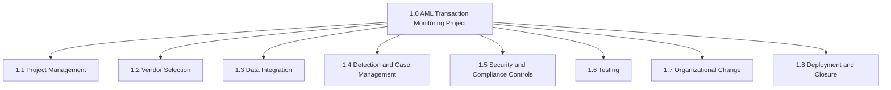

# Work Breakdown Structure (WBS)
## AML Transaction Monitoring System Implementation

## WBS dictionary (work packages)

| WBS ID | Work package | Owner |
|---|---|---|
| **1.1** | **Project Management** | |
| 1.1.1 | Initiation (business case, charter, stakeholders) | Project Manager |
| 1.1.2 | Planning and baselines | Project Manager |
| 1.1.3 | Monitoring, control and reporting | Project Manager |
| 1.1.4 | Steering Committee and change control | Project Manager |
| **1.2** | **Vendor Selection** | |
| 1.2.1 | Requirements and RFP | Project Manager, AML Ops Manager |
| 1.2.2 | Vendor demos and scoring | Evaluation panel |
| 1.2.3 | Security and data residency due diligence | Information Security |
| 1.2.4 | Contract negotiation and signing | Procurement, Legal |
| **1.3** | **Data Integration** | |
| 1.3.1 | Data mapping (transactions and customers) | IT Integration Lead |
| 1.3.2 | Daily extract build | Core Banking Support |
| 1.3.3 | Secure file transfer and load | IT Integration Lead, Vendor |
| 1.3.4 | Reconciliation controls | IT Integration Lead |
| 1.3.5 | Historical data load (13 months) | Vendor |
| **1.4** | **Detection and Case Management** | |
| 1.4.1 | Detection scenario design and thresholds | AML Ops Manager, Vendor |
| 1.4.2 | Scenario configuration | Vendor |
| 1.4.3 | Alert workflow (maker/checker) | Vendor, AML Ops Manager |
| 1.4.4 | STR and LCTR templates | Compliance Reporting Lead |
| 1.4.5 | Management dashboards | Vendor |
| **1.5** | **Security and Compliance Controls** | |
| 1.5.1 | Role based access design | Information Security |
| 1.5.2 | Audit logging and retention | Vendor, Information Security |
| 1.5.3 | Security assessment and penetration test | Information Security |
| **1.6** | **Testing** | |
| 1.6.1 | System and integration testing | Vendor, IT QA |
| 1.6.2 | User acceptance testing | AML Analysts, Test Lead |
| 1.6.3 | Parallel run (4 weeks) | AML Ops Manager |
| **1.7** | **Organizational Change** | |
| 1.7.1 | Updated AML procedures | Compliance Policy Lead |
| 1.7.2 | Training materials and sessions | Training Lead |
| 1.7.3 | Communications and super user network | Project Manager |
| **1.8** | **Deployment and Closure** | |
| 1.8.1 | Go live readiness and cutover | Project Manager, Head of IT |
| 1.8.2 | Hypercare (4 weeks) | Vendor, IT Support |
| 1.8.3 | Handover to operations | Project Manager |
| 1.8.4 | Lessons learned and closure | Project Manager |
