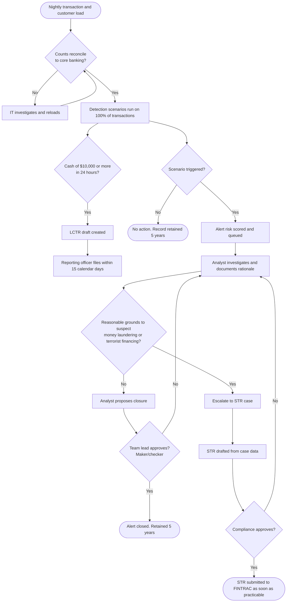

# AML Alert Workflow (Future State Process Map)
## AML Transaction Monitoring System Implementation

This map shows how a transaction moves from core banking through detection, investigation and reporting once the new system is live. The editable draw.io version is in [diagrams/aml_alert_workflow.drawio](diagrams/aml_alert_workflow.drawio) (open it at app.diagrams.net).

## Control points (where errors are prevented)

| Control | Type | What it prevents |
|---|---|---|
| Load reconciliation | Detective | Transactions silently missing from monitoring |
| 100% scenario coverage | Preventive | Suspicious activity going unreviewed because it was not sampled |
| Risk scoring and queue | Preventive | High risk alerts waiting behind low risk ones |
| Mandatory rationale | Preventive | Undocumented decisions that cannot be defended to an examiner |
| Maker/checker approval | Preventive | One person closing an alert wrongly, by mistake or on purpose |
| LCTR due date tracker | Preventive | Late large cash reports |
| Audit log and 5 year retention | Detective | Inability to reconstruct a decision during an audit or examination |

## Before and after

| Step | Before (manual) | After (automated) |
|---|---|---|
| Coverage | About 5% sampled | 100% screened daily |
| Finding patterns | Analyst spots them in spreadsheets | Six scenarios run automatically |
| Prioritizing | First in, first out | Risk score from 1 to 100 |
| Documenting | Email and spreadsheet comments | Mandatory rationale in case file |
| Approval | Informal, inconsistent | Enforced maker/checker |
| Reporting | Manual forms | Drafts generated from case data |
