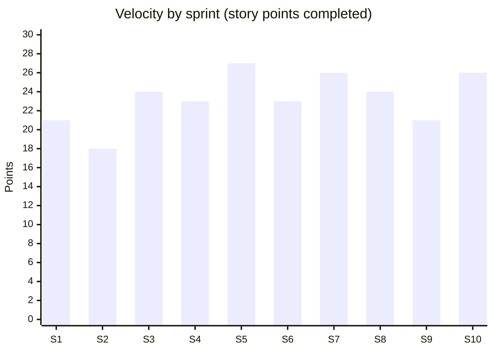

# Sprint Plan and Delivery Report
## AML Transaction Monitoring System Implementation

| Item | Detail |
|---|---|
| Framework | Scrum, two week sprints, 10 sprints (April 14 to August 29, 2025) |
| Product Owner | Priya Sharma, AML Operations Manager |
| Scrum Master | Blessing Adeniyi, PMP |
| Delivery team | 3 vendor consultants, 2 bank IT developers, 1 data analyst, 1 test analyst |
| Planned velocity | 22 to 26 story points per sprint |
| Tool | Jira (board and backlog), Confluence (sprint notes) |

## Ceremonies

| Ceremony | When | Length | Purpose |
|---|---|---|---|
| Sprint planning | Day 1 | 2 hours | Agree sprint goal and pull stories from the backlog |
| Daily stand up | Every day | 15 minutes | Yesterday, today, blockers |
| Backlog refinement | Day 6 | 1 hour | Split and estimate upcoming stories with the Product Owner |
| Sprint review | Day 10 | 1 hour | Demo to Product Owner, super users and Internal Audit |
| Retrospective | Day 10 | 45 minutes | What went well, what to improve, one action per sprint |

## Sprint results

| Sprint | Dates | Goal | Committed | Completed | Goal met? |
|---|---|---|---|---|---|
| 1 | Apr 14 to Apr 25 | Secure connection and first extract loaded in test | 21 | 21 | Yes |
| 2 | Apr 28 to May 9 | Customer and KYC data loaded and reconciled | 26 | 18 | Partly |
| 3 | May 12 to May 23 | Daily automated load running end to end | 24 | 24 | Yes |
| 4 | May 26 to Jun 6 | Structuring and large cash scenarios working | 23 | 23 | Yes |
| 5 | Jun 9 to Jun 20 | High risk jurisdiction and rapid movement scenarios | 27 | 27 | Yes |
| 6 | Jun 23 to Jul 4 | Profile and dormancy scenarios; e-Transfer design (CR001) | 23 | 23 | Yes |
| 7 | Jul 7 to Jul 18 | Alert workflow with maker/checker; e-Transfer feed live | 26 | 26 | Yes |
| 8 | Jul 21 to Aug 1 | STR and LCTR draft templates | 24 | 24 | Yes |
| 9 | Aug 4 to Aug 15 | Access roles, audit log, retention | 21 | 21 | Yes |
| 10 | Aug 18 to Aug 29 | Historical load, dashboards, hardening | 26 | 26 | Yes |
| | | **Total** | **241** | **233** | |

Average velocity: **23.3 points per sprint.** One story (US28, board trend reports, 8 points) was moved to the post go live backlog to make room for CR001.

## What happened in Sprint 2

Data profiling (US05) showed 3.2% of customer records were missing occupation or risk rating. The team stopped work on the automated load (US07, 8 points), which was carried into Sprint 3, and added a data cleansing story (US32) with the KYC team. This was logged as issue I02 in the [issue log](../04_execution/issue_log.md). Raising it early in Sprint 2 rather than discovering it in UAT was the main reason the schedule held.

## Retrospective actions (selected)

| Sprint | Action | Result |
|---|---|---|
| 1 | Vendor consultants join daily stand up instead of a separate weekly call | Blockers cleared in hours instead of days |
| 2 | Profile data before building on it | Adopted as a team rule for every new data source, including e-Transfers in CR001 |
| 4 | Product Owner reviews scenario test results mid sprint, not only at review | Fewer stories rejected at review |
| 7 | Add an Internal Audit reviewer to sprint reviews for control features | Audit raised zero new findings at UAT |
| 9 | Book UAT rooms and analyst time two sprints ahead | UAT started on time |
